<!-- The block between the cards markers is written by scripts/render_readme_cards.py. Edit the script, not the block. -->
<!-- cards:start -->

<!-- cards:end -->

  <a href="https://karthickrajans.vercel.app/">Website</a> ·
  <a href="https://www.linkedin.com/in/karthickrajan-s/">LinkedIn</a> ·
  <a href="https://twitter.com/karthick_124">X</a> ·
  <a href="https://www.instagram.com/karthick_124_/">Instagram</a> ·
  <a href="mailto:karthick1242004@gmail.com">karthick1242004@gmail.com</a>

